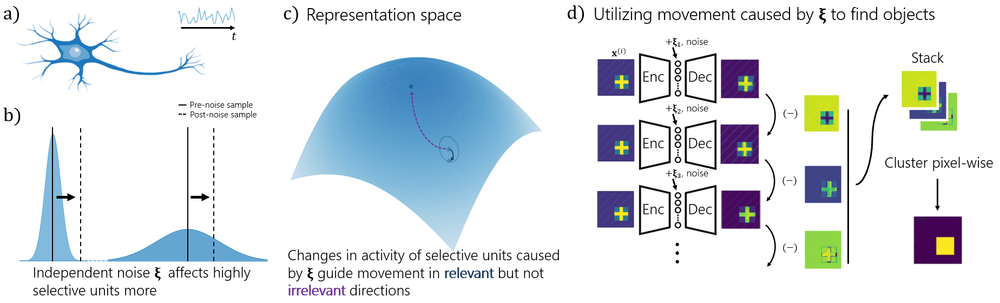

Check out our new pre-print: [Latent Noise Segmentation](https://arxiv.org/abs/2309.16515)! We show that neural noise can be used for unsupervised segmentation, and doing so reproduces many hallmark results of human perceptual grouping.

Link to pre-print: [https://arxiv.org/abs/2309.16515](https://arxiv.org/abs/2309.16515)
